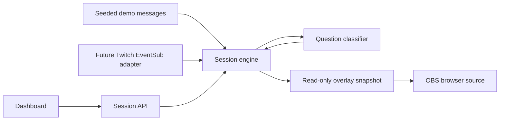

# Chat Copilot — Technical Specification

## Stack
Next.js App Router, TypeScript, React, Tailwind CSS, and Lucide icons. Use the user's familiar stack. Node.js 22 is installed. No database is needed for ephemeral demo sessions; PostgreSQL/Supabase can support recovery later.

## Runtime and Deployment
Local-first prototype, bound to 127.0.0.1. One long-running Next.js process owns session state and timers. Do not deploy this in serverless or multiple replicas without moving ingestion and state into a persistent worker/store. Nothing is being published as part of the initial build.

## Architecture


## Session Engine
### Counting and Actions
Implements `prd.md > Understanding Community Questions` and `Answering and Undoing`.
Message: id, userId, username, text, receivedAt. Group: id, title, supporting message IDs, answeredAt, cooldownUntil. Featured: stable snapshot of id, title, distinct count, featuredAt.
Count distinct user IDs in a rolling 60-second window. Repeated event IDs are ignored. Ranking is distinct-count descending, latest supporting message descending. Hold answered groups for five minutes; undo cancels suppression without featuring. Keep at most 2,000 recent messages and 100 groups, and expose capacity warnings. Trim expired data on every tick. A paused demo still ages data naturally.

### Persistence and Isolation
Random HttpOnly SameSite=Lax cookie identifies a server-owned session. Overlay receives a separate random read-only capability, never the dashboard cookie. Session state lives on globalThis to survive development hot reload. Expire idle sessions after two hours and cap the map at 50 sessions. Refresh preserves session state while the process lives; restart resets it.

## API
### Session Contract
GET /api/session creates or reads the browser session and returns its sanitized snapshot. POST /api/session accepts `{action, id?}` for start, pause, reset, feature, unfeature, answer, undo. Validate Origin against the request origin, JSON size and action type. The server—not the browser—owns message timestamps and counts. Return 400 for invalid input, 404 for unknown group and 409 for unavailable actions. Use no-store on responses.
GET /api/overlay/[token] returns only featured snapshot and demo designation. Invalid or expired capabilities return 404. Dashboard and overlay poll sequentially at one second; do not overlap requests. Overlay hides stale content after a request failure.

## Dashboard
### Demo Workspace
Implements `prd.md > Starting a Session`, `Understanding Community Questions`, and `Trust and Failure States`.
Three-column desktop layout: recent chat, ranked queue, and overlay preview. Stack on smaller screens. Demo label stays prominent. Rule-based demo grouping is explicitly labeled; it is not represented as AI. Initial empty state offers Start demo. Once started, the seeded scenario creates varied questions, unique users, duplicate chatter repetitions, and reactions. Controls pause/resume/reset. Answered tab exposes undo and remaining cooldown.

### Overlay
Implements `prd.md > Featuring a Question on Stream`.
Transparent page with a lower-third question card. Feature captures a stable count labeled "when featured." An OBS setup dialog gives a copyable capability URL and 1920x1080 guidance. A separate preview link opens the same output.

## Live Integrations (subsequent build steps)
### Twitch
Use OAuth authorization-code flow with server-side client secret, one-use expiring state tied to the session, and user:read:chat scope. Read the authenticated user's own channel. Validate tokens on entry and hourly, refresh before expiry. Subscribe to channel.chat.message after EventSub session_welcome. Support keepalive watchdog, reconnect handoff, resubscription after an unexpected close, and revocation. All credentials stay server-side. End the session and close sockets on disconnect.

### Semantic Grouping
Implemented 2026-10-30 in `src/lib/grouping.ts`, connected to the session timer and optional AI mode. Up to 40 unprocessed messages per call, 20-second timeout, 5-second minimum success interval, 10–60-second error backoff, and one in-flight call per session. No new calls after 30 seconds without dashboard heartbeat. Mode changes reset the session; generation checks and abort signals prevent stale results. Custom samples use `viewer: message` lines and remain labeled simulated. Only IDs and text are sent to the model, not viewer metadata.

Batch recent unprocessed messages every few seconds. Use OpenAI Responses with strict JSON schema for assignments to existing or new groups. Existing cooldown groups are included to suppress paraphrases. Validate all IDs, group limits, and references before applying results. Counts and examples come only from original messages. API failures produce visible degraded state, never a silent rule-based fallback. Configure OPENAI_API_KEY and OPENAI_MODEL locally. No external AI requests are needed for the initial demo milestone.

## File Structure
```
src/app/layout.tsx                 # page metadata and shared CSS
src/app/page.tsx                   # dashboard entry
src/app/globals.css                # responsive visual system
src/app/overlay/[token]/page.tsx   # transparent OBS entry
src/app/api/session/route.ts       # protected session actions
src/app/api/overlay/[token]/route.ts # read-only capability
src/components/dashboard.tsx      # streamer UI
src/components/overlay.tsx        # OBS polling and output
src/lib/engine.ts                 # testable state transitions
src/lib/demo.ts                   # labeled synthetic traffic
src/lib/store.ts                  # server-owned session lifecycle
tests/engine.test.ts              # counting, expiry, cooldown invariants
docs/                            # scope, PRD, spec, checklist
README.md                        # run instructions and limitations
```

## References
- https://nextjs.org/docs/app/getting-started/installation
- https://tailwindcss.com/docs/installation/framework-guides/nextjs
- https://dev.twitch.tv/docs/chat/authenticating/
- https://dev.twitch.tv/docs/eventsub/handling-websocket-events/
- https://dev.twitch.tv/docs/authentication/getting-tokens-oauth/
- https://developers.openai.com/api/docs/guides/structured-outputs

## Review Findings
The initial demo is an interaction prototype, not semantic-AI validation. Live integration and classifier evaluation remain separate checklist items. The process-memory architecture requires a single persistent server. Overlay capabilities must expose no raw chat or controls. Original messages expire independently of featured snapshots so counts cannot silently remain labeled live.
